# Ops Copilot — Architecture

An AI copilot for operations/support agents. When a customer complaint arrives
("my card was declined", "my rent payment never went out", "my direct debit
failed"), the copilot automatically investigates the customer's banking data,
explains the root cause with evidence, and recommends the next action. By the
time an ops agent opens the case, the diagnosis is waiting for their review.

## Goals

- Diagnose the common issue types: **card declines**, **missed scheduled payments**, **failed direct debits**, with a fallback for anything else.
- **Investigate automatically** as soon as a case arrives, so the ops agent starts from a diagnosis instead of from scratch.
- Every diagnosis is grounded in tool evidence (no evidence → no conclusion).
- Measure diagnosis accuracy against a labelled dataset and track it over time.
- Human in the loop: the copilot proposes, the ops agent accepts, corrects or rejects.
- **Simulate complaints** on demand, so the system can be demoed and tested with realistic, fresh cases.
- **Local-first:** the whole system runs on a laptop with `docker compose up`. The only cost is LLM tokens, and switching to a local model makes it free.

## Tech stack

| Concern | Choice |
|---|---|
| Agent runtime | Python 3.12, FastAPI, LangGraph |
| LLM access | LiteLLM proxy → Anthropic API (Claude), or Ollama for a free local model |
| Observability & evals | Langfuse, self-hosted in Docker (traces, scores, datasets) |
| Banking domain service (mock core banking) | Java 21, Spring Boot 3 |
| Persistence | PostgreSQL (domain data, cases, investigations, job queue, LangGraph checkpoints) |
| Ops console | Angular |
| Runtime | Docker Compose (primary); AWS via Terraform as an optional later step |
| CI/CD | GitHub Actions (tests, offline eval gate, image build) |

### Cost

| Component | Cost |
|---|---|
| Everything in Docker Compose (services, Postgres, Langfuse, LiteLLM, Ollama) | Free |
| Anthropic API | Pay per token; a POC investigation is roughly cents |
| GitHub Actions | Free for public repos; monthly free minutes for private repos |
| AWS (optional, later) | Hourly charges for Fargate, RDS, load balancer, plus Bedrock tokens |

---

## 1. System context

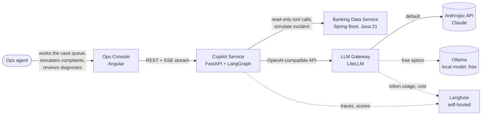

## 2. Containers and data stores

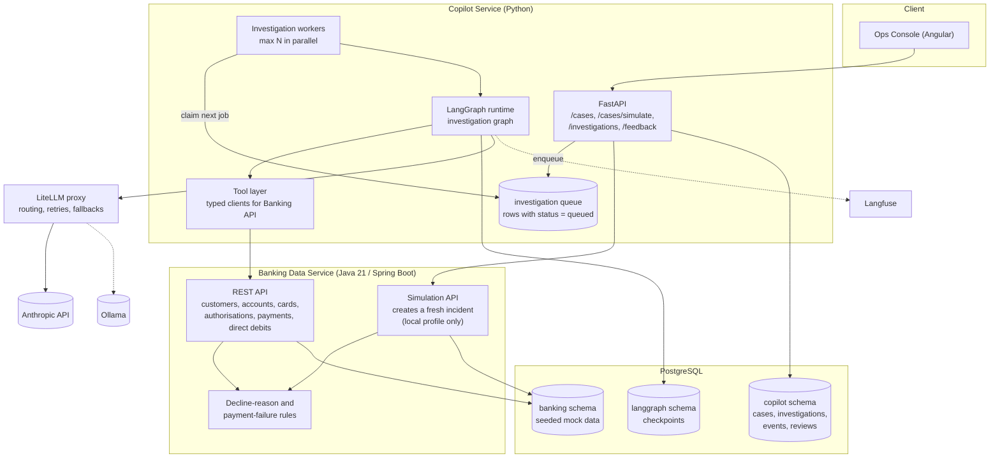

**Model routing via LiteLLM.** The copilot only ever asks for two model aliases; the LiteLLM config maps them to real models, so switching provider is a config change, not a code change.

| Alias | Used for | Default (Anthropic API) | Free profile (Ollama) |
|---|---|---|---|
| `copilot-fast` | triage, summaries | small Claude model (Haiku) | small local model, e.g. Llama 3.1 8B |
| `copilot-reasoning` | investigation loop, diagnosis | larger Claude model (Sonnet) | larger local model with tool calling, e.g. Qwen 2.5 14B |

The profile is chosen with an environment variable (for example `LLM_PROFILE=anthropic` or `LLM_PROFILE=ollama`). Expect lower diagnosis accuracy from small local models; they are good enough for building and testing the flow, and the eval loop (section 8) shows the difference in numbers.

## 3. Cases and automatic investigation

A **case** is a customer complaint waiting for an ops agent. An **investigation**
is one run of the copilot on a case. Every new case is investigated
automatically; the ops agent can re-run it (for example after rejecting a
diagnosis), which creates a new investigation on the same case.

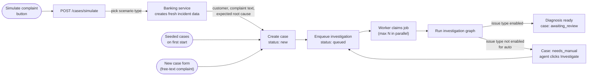

### Case lifecycle

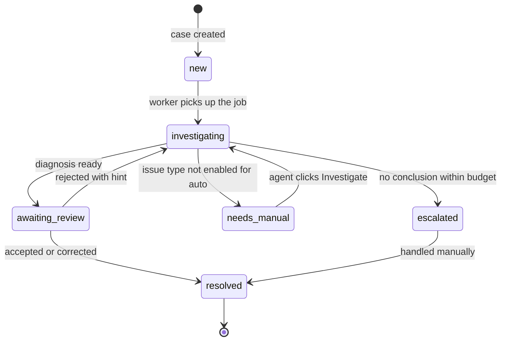

### How the automatic run works

- **Trigger.** Creating a case (from any source) inserts the case and a `queued` investigation in **one transaction**, then sends a Postgres `NOTIFY` to wake the workers. No separate message broker is needed for the POC.
- **Workers.** The copilot service runs a small pool of background workers (`MAX_PARALLEL_INVESTIGATIONS`, default 3; use 1 with Ollama). Each worker claims the oldest queued job with `SELECT … FOR UPDATE SKIP LOCKED`, so two workers never take the same job, and jobs survive a restart. If a worker dies mid-run, the job is retried and LangGraph resumes from the last checkpoint.
- **One active investigation per case.** Clicking Investigate while one is queued or running just opens the existing one.
- **Which issue types run automatically.** `AUTO_INVESTIGATE_TYPES=card_decline,missed_payment,failed_direct_debit`. The graph always runs the cheap triage step first; if the issue type is not in the list, it stops there and marks the case `needs_manual`, so tokens are not spent on cases the copilot is not built for.
- **Streaming still works.** Workers save every event (step, tool call, evidence, tokens of the final explanation) to the `investigation_event` table. When the ops agent opens a case, the console replays the saved events over SSE and then continues live if the run is still going.
- **Later.** If volume grows, the Postgres queue can be swapped for RabbitMQ or SQS without changing the graph.

### Simulate complaint

The **Simulate complaint** button in the case queue creates a realistic new case end to end:

1. The console calls `POST /cases/simulate` (optionally with a scenario type; random by default).
2. The copilot service calls the banking service's simulation API, for example `POST /simulation/incidents {"type": "card_decline"}`.
3. The banking service picks a customer and inserts **fresh data that causes the problem**, timestamped now: for example a frozen card plus a declined authorisation at a petrol station, or a direct debit collection that failed because the mandate was cancelled.
4. It returns the customer, a complaint written the way a customer would say it (several phrasings per scenario), and the **expected root cause**.
5. The copilot service creates the case with channel `simulated` and stores the expected root cause on it, **hidden from the copilot and the ops agent**.
6. The automatic investigation starts; the case appears in the queue and fills in live.

Because simulated cases carry the expected root cause, every one of them is scored automatically in Langfuse (`diagnosis_correct`), on top of the ops agent's review. The simulation API is only enabled in the local profile (`SIMULATION_ENABLED=true`) and is never part of the tools the copilot can call.

| Scenario type | Example root causes the simulator can create |
|---|---|
| Card decline | card frozen, insufficient funds, merchant category blocked, card expired, contactless limit, fraud rule |
| Missed payment | insufficient funds on the run date, payee account closed, daily payment limit exceeded |
| Failed direct debit | mandate cancelled, insufficient funds, account closed by originator |

### Console screens

1. **Case queue:** open cases with customer, complaint snippet, age, issue type and status (`investigating`, `awaiting_review`, `needs_manual`, …). Buttons: **Simulate complaint** (with an optional scenario-type picker) and **New case**.
2. **Case detail:** complaint and customer summary; the investigation timeline (live or replayed); the diagnosis with linked evidence; the review panel (accept, correct, reject with hint). Earlier investigations of the same case are listed below.
3. **New case form:** pick a customer, write any complaint, choose a channel. For trying edge cases by hand.

## 4. Investigation graph (LangGraph)

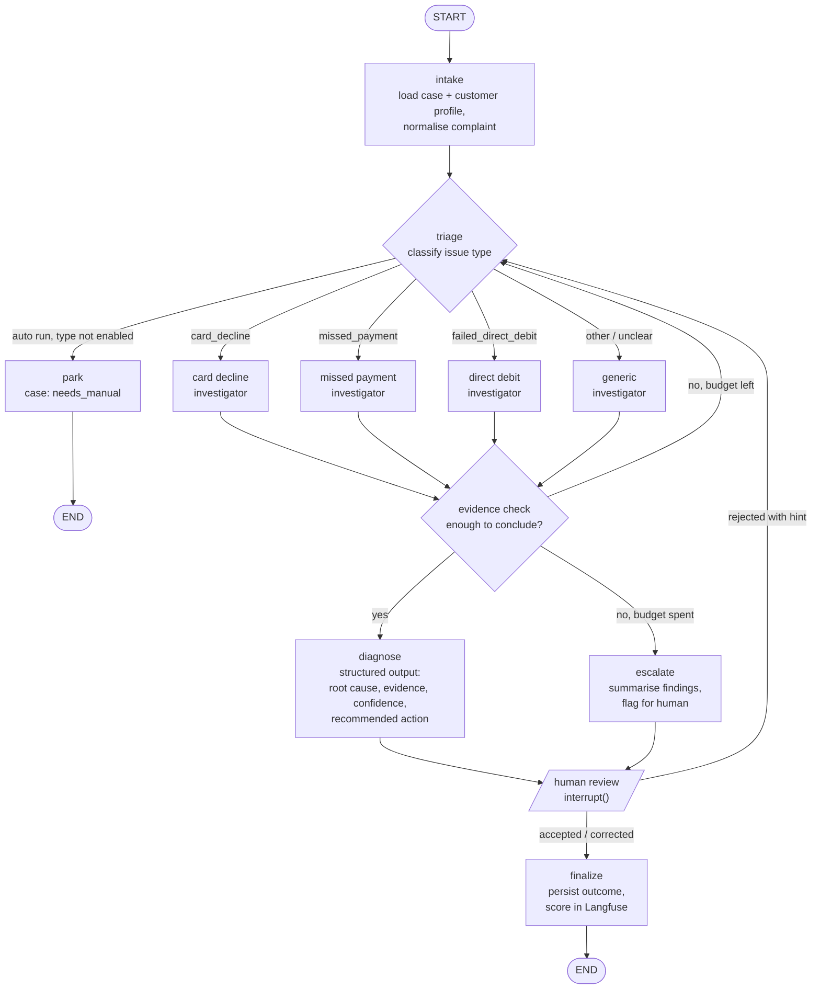

The `park` route only applies to automatic runs. When the ops agent clicks
Investigate on a `needs_manual` case, the run is marked as manual and triage
continues to the matching investigator (usually `generic`).

Each investigator is a ReAct-style subgraph with a **playbook prompt** and a
**restricted tool set** for its issue type:

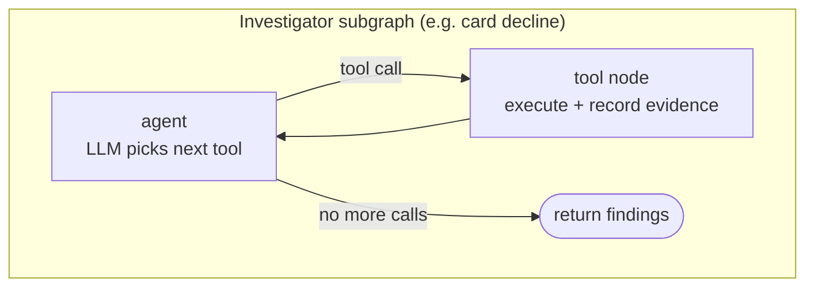

| Issue type | Tools available |
|---|---|
| Card decline | `get_cards`, `get_card_authorisations`, `get_account_balance`, `get_card_controls`, `get_fraud_flags` |
| Missed payment | `get_scheduled_payments`, `get_payment_attempts`, `get_account_balance`, `get_transactions`, `get_payee` |
| Failed direct debit | `get_mandates`, `get_direct_debit_collections`, `get_account_balance`, `get_transactions` |
| Generic | read-only union of the above, smaller step budget |

**Graph state** (sketch):

```python
class InvestigationState(TypedDict):
    investigation_id: str
    case_id: str
    customer_id: str
    complaint: str
    trigger: Literal["auto", "manual"]
    issue_type: Literal["card_decline", "missed_payment", "failed_direct_debit", "other"]
    evidence: Annotated[list[Evidence], operator.add]   # every tool result cited
    steps_used: int
    diagnosis: Diagnosis | None                         # root_cause, confidence, evidence_ids, action
    reviewer_feedback: str | None
```

## 5. Investigation sequence (simulated complaint)

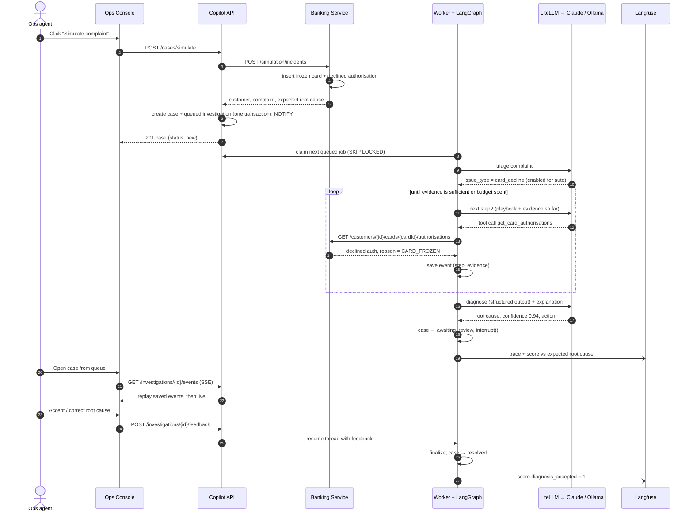

## 6. Streaming to the console

- The console opens `GET /investigations/{id}/events` as Server-Sent Events.
- Events are our own small set of types (`step_started`, `classified`, `tool_call`, `evidence`, `token`, `diagnosis`, `awaiting_review`, `status_changed`), mapped from LangGraph's `updates`, `messages` and `custom` stream modes.
- Only the final plain-language explanation is streamed token by token; triage, tool calls and the structured diagnosis are sent as complete events.
- Every event is stored with an increasing id, so a refresh or reconnect (`Last-Event-ID`) replays what was missed and then continues live.
- The case queue receives `status_changed` events over a second SSE stream (`GET /cases/events`), so new simulated cases and status changes appear without refreshing.

## 7. Data model

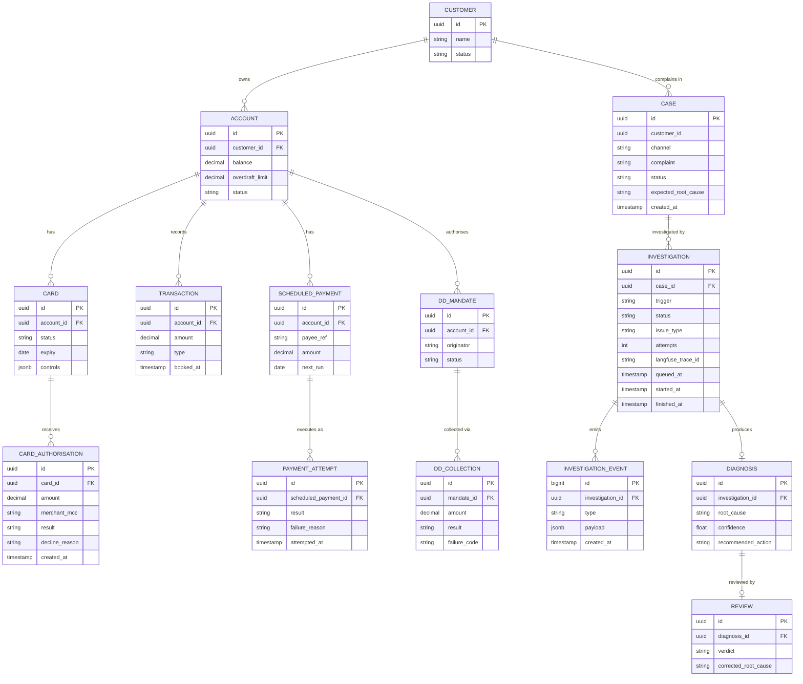

- `CASE.channel` is `chat`, `email`, `phone` or `simulated`. `expected_root_cause` is only set for simulated and seeded cases and is never shown to the copilot or the ops agent.
- `INVESTIGATION.status` is `queued`, `running`, `awaiting_review`, `completed` or `failed`; the `queued` rows are the job queue the workers claim from.
- `INVESTIGATION_EVENT` holds everything streamed to the console, so a case can be replayed after the fact.

The banking tables live in the Spring Boot service's schema and are seeded with
scenarios that each have one known root cause. The simulation API uses the same
scenario definitions to create fresh incidents, and the same scenarios make up
the evaluation dataset.

## 8. Evaluation loop

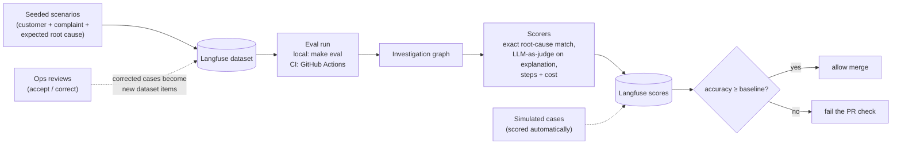

**Headline metrics:**
- **Diagnosis accuracy** = diagnoses whose root cause matches the expected one (simulated and eval cases) or was accepted unchanged by the ops agent ÷ all scored diagnoses.
- **Time to diagnosis** = case created → diagnosis ready (automatic run), and case created → review (end to end).

The same dataset can be run against each LiteLLM profile, so Claude and the
local Ollama models can be compared side by side in Langfuse.

In CI, the eval job starts the Compose stack and uses the Anthropic API (the
key is a GitHub Actions secret). Ollama models are usually too slow and large for
free CI runners, so the Ollama profile is evaluated locally.

## 9. Local runtime (Docker Compose)

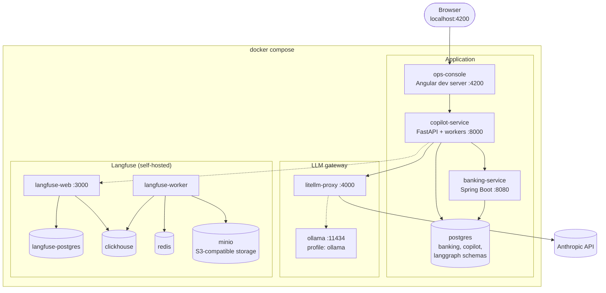

- `docker compose up` starts everything except Ollama. `docker compose --profile ollama up` adds Ollama, and `LLM_PROFILE=ollama` points LiteLLM at it.
- The only secret is `ANTHROPIC_API_KEY`, read from a git-ignored `.env` file. Not needed with the Ollama profile.
- Self-hosted Langfuse brings its own Postgres, ClickHouse, Redis and MinIO; keep them separate from the app's Postgres so either can be reset independently.
- On a Mac, Ollama runs much faster natively (using the GPU) than inside Docker. In that case skip the `ollama` container and point LiteLLM at `host.docker.internal:11434`.
- The workers run inside the `copilot-service` container for the POC. They can later move to their own container (same image, different start command) to scale separately from the API.

## 10. Optional later: AWS deployment

Not needed for the POC. If the app is later hosted on AWS, the same container
images move to ECS, and only the LiteLLM config changes (Anthropic API → Bedrock,
or keep the Anthropic API).

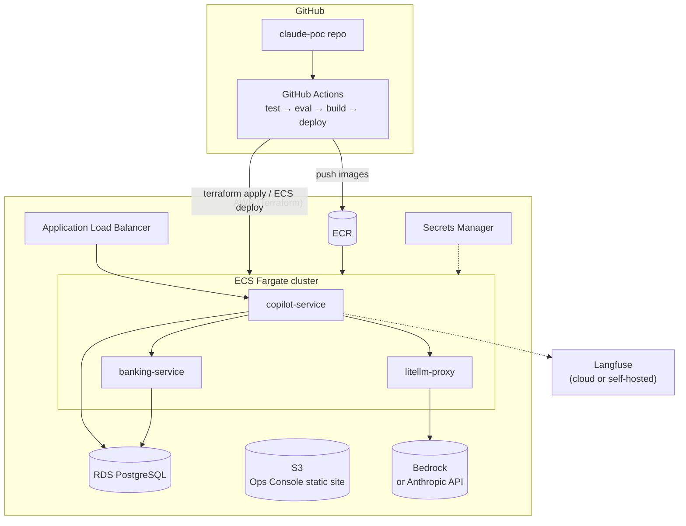

## Proposed repo layout

```
claude-poc/
├── docs/architecture.md
├── copilot-service/      # Python, FastAPI, LangGraph, workers
├── banking-service/      # Java 21, Spring Boot (incl. simulation API)
├── ops-console/          # Angular
├── infra/
│   ├── docker-compose.yml
│   ├── litellm/
│   │   ├── anthropic.yaml   # default profile
│   │   └── ollama.yaml      # free local profile
│   └── terraform/           # optional, later
├── .env.example          # ANTHROPIC_API_KEY, LLM_PROFILE, AUTO_INVESTIGATE_TYPES, Langfuse keys
└── .github/workflows/
```
