# Payments Support AI — Architecture

Two AI agents on one shared platform, covering a payments-support journey end to end:

1. **In-app customer assistant.** A customer asks a question in the app ("why was my card declined?", "my rent didn't go out", "the gym says my direct debit failed"). The assistant categorises the question, answers it from the knowledge base and the customer's own data, and resolves it without a human where it can. When it can't, it **hands off** to the ops team as an already-categorised case with the transcript and evidence attached.
2. **Ops copilot.** Every new case, whether handed off by the assistant or arriving from another source (email, phone, an ops agent), is investigated automatically. The copilot explains the root cause with evidence and recommends the next action; an ops agent reviews every diagnosis.

## Goals

**Customer assistant**
- Resolve common payment and card questions without a human, measured as the **containment rate**.
- Hand off at the right moments (low confidence, sensitive topics, the customer asks, repeated failure) and never hold on to a case it should not.
- Answers grounded in the knowledge base and the customer's own data; no invented facts, no financial advice, read-only.

**Ops copilot**
- Diagnose the common issue types: **card declines**, **missed scheduled payments**, **failed direct debits**, with a fallback for anything else.
- **Investigate automatically** as soon as a case arrives, so the ops agent starts from a diagnosis instead of from scratch.
- Every diagnosis is grounded in tool evidence (no evidence → no conclusion); a human reviews every diagnosis.

**Platform**
- One shared core (triage, banking tools, LLM access, tracing, guardrails) used by both agents.
- **Simulated customers** that chat with the assistant like real ones, so the whole journey can be demoed and measured with fresh, realistic incidents.
- Accuracy and outcome metrics for both agents, tracked over time.
- **Local-first:** the whole system runs on a laptop with `docker compose up` and local open models through Ollama, at no cost by default. Claude through the Anthropic API is one setting away, paid per token, and is used for evals and demos once the system works.

## Tech stack

| Concern | Choice |
|---|---|
| Agent runtime | Python 3.12, FastAPI, LangGraph (two graphs: `assistant`, `investigation`) |
| LLM access | LiteLLM proxy → Ollama (local open models, default, free), or Anthropic API (Claude, paid) |
| Knowledge base search | PostgreSQL + pgvector; embeddings with a small local model (fastembed, in-process) |
| Observability & evals | Langfuse, self-hosted in Docker (traces, scores, datasets) |
| Banking domain service (mock core banking) | Java 21, Spring Boot 3 |
| Persistence | PostgreSQL (domain data, conversations, cases, investigations, job queue, LangGraph checkpoints, knowledge base) |
| Front-ends | Angular workspace with two apps: `customer-app` and `ops-console` |
| Runtime | Docker Compose (primary); AWS via Terraform as an optional later step |
| CI/CD | GitHub Actions (tests, offline eval gate, image build) |

### Cost

| Component | Cost |
|---|---|
| Everything in Docker Compose (services, Postgres, Langfuse, LiteLLM, Ollama) | Free |
| Embeddings for the knowledge base | Free (local model, in-process) |
| Anthropic API (optional) | Pay per token from prepaid API credits, billed separately from any Claude subscription; a POC conversation or investigation is roughly cents. Not needed while building. |
| GitHub Actions | Free for public repos; monthly free minutes for private repos |
| AWS (optional, later) | Hourly charges for Fargate, RDS, load balancer, plus Bedrock tokens |

---

## 1. System context

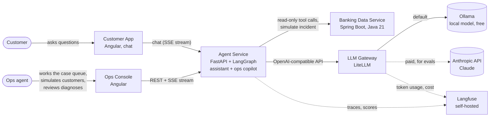

## 2. Containers and data stores

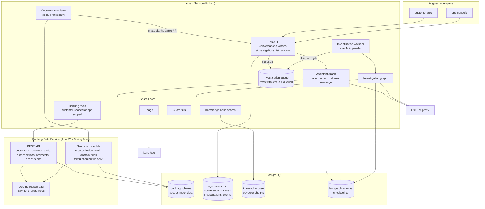

**Model routing via LiteLLM.** The agent code never names a model or a provider. Each step asks for an **alias** named after its role, and a **profile** (one LiteLLM config file) maps every alias to a real model. Switching provider, or moving one step to another model, is a config change, not a code change.

| Alias | Used for | Needs |
|---|---|---|
| `triage` | triage, input guard | fast, cheap, reliable structured output |
| `assistant` | customer replies, handoff summaries | good tone, grounded answers, light tool calling |
| `reasoning` | investigation loop, diagnosis, the copilot's explanation | multi-step tool calling, careful reasoning over evidence |
| `simulator` | simulated customers, generating new scenarios | cheap, high volume, never seen by real customers |
| `judge` | output grounding guard, LLM-as-judge evals | at least as strong as the models it checks |

| Profile | `triage` | `assistant` | `reasoning` | `simulator` | `judge` | Needs |
|---|---|---|---|---|---|---|
| `anthropic` (paid, quality baseline) | small Claude model (Haiku) | small Claude model (Haiku) | larger Claude model (Sonnet) | small Claude model (Haiku) | larger Claude model (Sonnet) | `ANTHROPIC_API_KEY` |
| `ollama` (default, free) | small local model, e.g. Llama 3.1 8B | larger local model, e.g. Qwen 2.5 14B | larger local model with tool calling, e.g. Qwen 2.5 14B | small local model | larger local model | Ollama running |
| `mixed` | small local model | small Claude model | larger Claude model | small local model | larger Claude model | both |
| `aws` (optional, section 12) | open model on Bedrock | Claude on Bedrock | Claude on Bedrock | open model on Bedrock | Claude on Bedrock | AWS credentials |

- The profile is chosen with an environment variable, for example `LLM_PROFILE=mixed`; it defaults to `ollama`. The model names are examples; each profile file pins exact versions.
- **Build on `ollama`, then measure with Claude.** The system is built and run day to day on the free `ollama` profile. Once it works end to end, API credits are added and the evals run on `anthropic` (the quality baseline) and `mixed`. Prompts and graphs that work on small local models tend to be robust on stronger ones.
- **`mixed` is the profile the evals are expected to point to:** open models where they hold up (classification and simulation), Claude on the agentic and customer-facing steps. Which steps actually move is decided by the profile comparison in section 10, not in advance.
- Every trace carries the profile and the alias as metadata, so Langfuse scores, cost and latency can be split by both.
- Profiles can also set **fallbacks** (for example `reasoning` falls back from the Anthropic API to Bedrock if it fails or rate-limits) and per-alias budgets and rate limits.
- Small local models give lower accuracy, especially on long tool-calling chains; the eval loop shows the difference in numbers.

## 3. Shared platform

Both agents are LangGraph graphs in the same Python codebase and share one core:

| Component | Used by the assistant | Used by the ops copilot |
|---|---|---|
| **Triage** (categorise into `card_decline`, `missed_payment`, `failed_direct_debit`, `other`) | Categorises every customer question | Verifies the category on handed-off cases; full triage for cases from other sources |
| **Signal snapshot** (recent declines, failed payments, failed DD collections, account status; plain API calls, no LLM) | Grounds triage and answers | Grounds triage |
| **Banking tools** | Customer-scoped subset | Full read-only set |
| **Knowledge base search** | Yes | Optional (policy lookups) |
| **Guardrails** | Input and output checks | Evidence-grounding check |
| **LLM access, tracing** | LiteLLM aliases, Langfuse | Same |

**Tool scoping.** Tools are plain Python functions with typed inputs. The **customer-scoped** versions never take a `customer_id` from the LLM: the server injects it from the logged-in session, so the assistant cannot read another customer's data however it is prompted. They also return customer-safe fields only (for example a decline reason such as "card frozen", but never fraud-rule details or internal codes). The **ops-scoped** versions return the full records.

Triage itself is one short `triage` call with structured output (category, confidence, optional secondary category, one-line reasoning), grounded by the signal snapshot. Below a confidence threshold it returns `other`.

## 4. In-app customer assistant

### Assistant graph

Each customer message runs the graph once. The conversation is a LangGraph thread (`thread_id = conversation_id`), so history and earlier evidence are kept between messages.

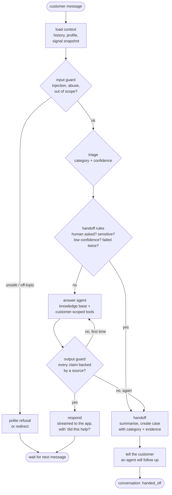

- **Answer agent.** A ReAct loop like the investigators, with a playbook per category and a small step budget (a customer is waiting). It can call `search_knowledge_base` and the customer-scoped banking tools, and must cite which source backs each statement.
- **Resolution.** A conversation is `resolved` when the customer confirms the answer helped, or when it goes quiet after an answer and no new conversation or case about the same issue follows within 7 days. Otherwise it ends `handed_off` or `abandoned`.
- **Streaming.** The final answer is streamed token by token to the app (unlike the ops copilot, the customer-facing answer is the main output).

### Handoff rules

The assistant hands off when any of these is true:

| Rule | Example |
|---|---|
| The customer asks for a human | "Can I talk to someone?" |
| Sensitive topic | suspected fraud, a vulnerable customer, a formal complaint, bereavement |
| The fix needs a human action | a fraud block that only ops can lift, a refund decision |
| Low confidence | triage confidence below threshold, or the evidence does not explain the problem |
| Repeated failure | the output guard rejected two answers, or the customer said "that didn't help" twice |

The handoff creates a case with `source = assistant_handoff`, the **category**, the **conversation transcript**, a short **summary**, and the **evidence** already gathered. The ops copilot starts from there (section 5).

### Guardrails

- **Input guard:** a `triage`-alias check (plus simple rules) for prompt injection ("ignore your instructions…", requests for other customers' data), abuse, and topics outside payments and cards. Off-topic questions get a polite redirect.
- **Scope by construction:** customer-scoped tools with a server-injected `customer_id`; read-only in v1 (no freezing cards, no payments).
- **Output guard:** a `judge`-alias check that every factual statement about the customer's account is backed by a tool result, and every policy statement by a knowledge base article; otherwise the answer is regenerated once, then handed off. It also blocks financial advice and internal details (fraud rules, risk scores, internal codes).
- **Data handling:** card numbers and other sensitive identifiers are masked before anything is sent to the LLM or to Langfuse.

### Knowledge base

- Markdown articles in the repo (`knowledge-base/`), for example: why cards get declined, card controls and limits, how and when scheduled payments run, how direct debits and mandates work, fees, how to contact support.
- At startup the agent service splits the articles into chunks, embeds them with a small local embedding model (fastembed, in-process, free) and stores them in Postgres with **pgvector**. Search combines vector similarity with keyword matching.
- Answers cite the article they used, and the app shows it as a link.

### Customer app

- A phone-sized web app in the same Angular workspace as the ops console.
- **"Log in as"** picker with the seeded customers (local development only, no real authentication).
- A minimal account view (cards with their status, recent transactions) and the **chat**, with streamed answers, source links, and 👍 / 👎 on each answer.
- A **watch mode** that shows a simulated customer's conversation live (section 5).

## 5. Cases and automatic investigation

A **case** is a problem waiting for the ops team. An **investigation** is one run of the ops copilot on a case. Every new case is investigated automatically; the ops agent can re-run it (for example after rejecting a diagnosis), which creates a new investigation on the same case.

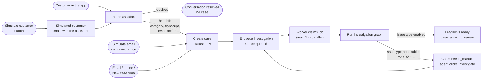

**Case sources** (`CASE.source`): `assistant_handoff`, `email`, `phone`, `ops_manual`, `simulated_email`, and later `event` for event-triggered investigations. Handed-off cases arrive with a category; the others do not. The complaint text is optional, and an event payload (`trigger_payload`) can be stored instead.

### Case lifecycle

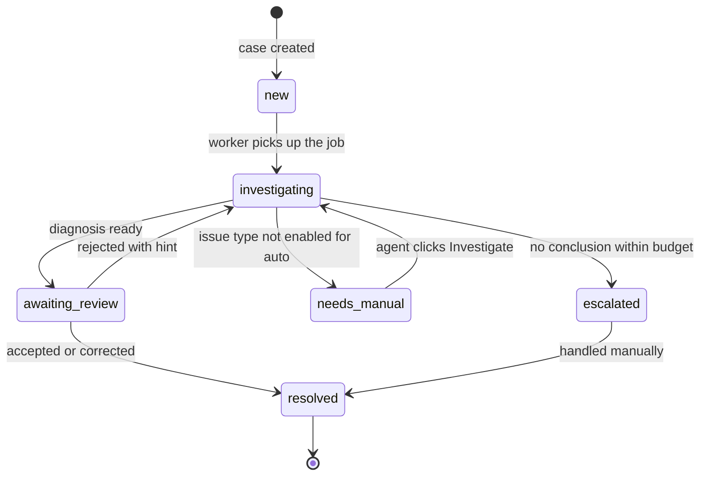

### How the automatic run works

- **Trigger.** Creating a case (from any source) inserts the case and a `queued` investigation in **one transaction**, then sends a Postgres `NOTIFY` to wake the workers. No separate message broker is needed for the POC.
- **Workers.** A small pool of background workers in the agent service (`MAX_PARALLEL_INVESTIGATIONS`, default 1 for the `ollama` profile, 3 with Claude). Each worker claims the oldest queued job with `SELECT … FOR UPDATE SKIP LOCKED`, so two workers never take the same job, and jobs survive a restart. If a worker dies mid-run, the job is retried and LangGraph resumes from the last checkpoint.
- **One active investigation per case.** Clicking Investigate while one is queued or running just opens the existing one.
- **Which issue types run automatically.** `AUTO_INVESTIGATE_TYPES=card_decline,missed_payment,failed_direct_debit`. Cases of other types stop after triage and are marked `needs_manual`.
- **Later.** If volume grows, the Postgres queue can be swapped for RabbitMQ or SQS without changing the graphs.

### Simulation

Two buttons in the ops console (and matching `make` targets):

**Simulate customer** (the full journey)
1. The agent service asks the banking service's simulation module for an incident of a given or random type, for example `POST /simulation/incidents {"type": "card_decline"}`.
2. The banking service sets up the situation through its **real domain operations and rules** (for example: freeze the card, then process card payments through the normal authorisation logic, which declines them with `CARD_FROZEN`). It returns the customer, what the customer would know and say, the **expected root cause**, and the **expected outcome**: `self_serve` (the assistant should resolve it) or `needs_human` (the assistant should hand off, for example a fraud block).
3. A **simulated customer** (a `simulator`-alias LLM with a persona: how vague, how patient, how they phrase things) opens a conversation and chats with the assistant **through the same API as the customer app**, for up to a set number of turns. It only knows what a real customer would know.
4. The conversation ends resolved or handed off. A handoff creates a case, which is investigated automatically.
5. Expected root cause and expected outcome are stored on the conversation and case, **hidden from both agents and the ops agent**, so every simulated journey is scored automatically (section 10).

You can watch the conversation live in the customer app's watch mode, then follow the case in the ops console.

**Simulate email complaint** skips the assistant: it creates the incident and a case with `source = simulated_email` and no category, to exercise the ops copilot's full triage on its own.

**Scope of the simulation.** In a real system nothing is simulated: incidents come from real activity, and test environments would use a separate traffic generator acting as the outside world. Here the banking service is itself a stand-in for core banking and its surroundings, so its simulation module, gated behind a Spring profile (`@Profile("simulation")`) and calling only the service's own domain logic, is a deliberate POC shortcut. The customer simulator lives in the agent service behind `SIMULATION_ENABLED=true`. Neither is ever available as a tool to the agents.

| Scenario type | Example root causes | Expected outcome |
|---|---|---|
| Card decline | card frozen by the customer, insufficient funds, card expired, contactless limit, merchant category blocked | `self_serve` |
| Card decline | fraud rule triggered | `needs_human` |
| Missed payment | insufficient funds on the run date, daily payment limit exceeded | `self_serve` |
| Missed payment | payee account closed | `needs_human` |
| Failed direct debit | mandate cancelled by the customer, insufficient funds | `self_serve` |
| Failed direct debit | account closed by the originator | `needs_human` |

### Ops console screens

1. **Case queue:** open cases with customer, source, category, age and status. Buttons: **Simulate customer**, **Simulate email complaint** (each with an optional scenario-type picker) and **New case**.
2. **Case detail:** the case summary, and for handed-off cases the **conversation transcript** and the assistant's category and evidence; the investigation timeline (live or replayed); the diagnosis with linked evidence; the review panel (accept, correct, reject with hint). Earlier investigations of the same case are listed below.
3. **Conversations:** a list of assistant conversations with outcome (resolved, handed off, abandoned), for spot checks.
4. **New case form:** pick a customer, write any complaint, choose a source.

## 6. Investigation graph (LangGraph)

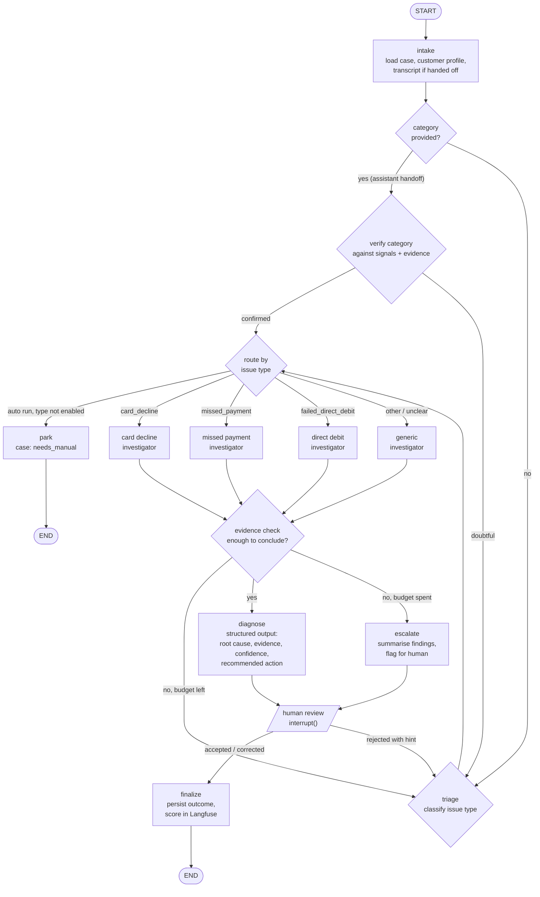

- **Verify, don't trust.** A handed-off case already has a category and evidence from the assistant. The copilot checks that category against the signal snapshot and that evidence (no full triage call) and only falls back to triage when it does not hold up. How often it changes the category is tracked as a metric.
- The `park` route only applies to automatic runs. When the ops agent clicks Investigate on a `needs_manual` case, the run is marked as manual and continues to the matching investigator (usually `generic`).

Each investigator is a ReAct-style subgraph with a **playbook prompt** and a **restricted tool set** for its issue type:


| Issue type | Tools available (ops-scoped) |
|---|---|
| Card decline | `get_cards`, `get_card_authorisations`, `get_account_balance`, `get_card_controls`, `get_fraud_flags` |
| Missed payment | `get_scheduled_payments`, `get_payment_attempts`, `get_account_balance`, `get_transactions`, `get_payee` |
| Failed direct debit | `get_mandates`, `get_direct_debit_collections`, `get_account_balance`, `get_transactions` |
| Generic | read-only union of the above, smaller step budget |

**Graph state** (sketch):

```python
class InvestigationState(TypedDict):
    investigation_id: str
    case_id: str
    customer_id: str
    complaint: str | None
    transcript_summary: str | None                      # from an assistant handoff
    trigger: Literal["auto", "manual"]
    provided_category: str | None                       # from an assistant handoff
    issue_type: Literal["card_decline", "missed_payment", "failed_direct_debit", "other"]
    evidence: Annotated[list[Evidence], operator.add]   # every tool result cited, incl. the assistant's
    steps_used: int
    diagnosis: Diagnosis | None                         # root_cause, confidence, evidence_ids, action
    reviewer_feedback: str | None
```

## 7. End-to-end sequence (simulated customer, handed off)

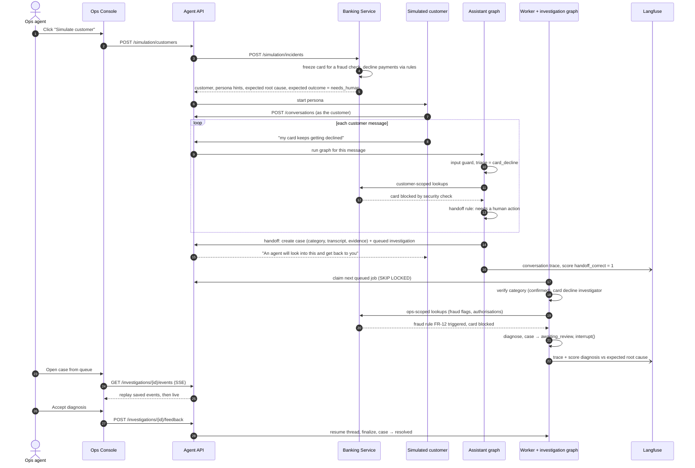

## 8. Streaming to the front-ends

| Stream | Endpoint | What streams |
|---|---|---|
| **Customer chat** | `POST /conversations/{id}/messages` (response is an SSE stream) | Answer tokens, source links, handoff notice |
| **Investigation timeline** | `GET /investigations/{id}/events` | `step_started`, `classified`, `tool_call`, `evidence`, `token` (final explanation only), `diagnosis`, `awaiting_review` |
| **Case queue** | `GET /cases/events` (or polling) | `case_created`, `status_changed` |

- Event types are our own, mapped from LangGraph's `updates`, `messages` and `custom` stream modes.
- Investigation events are stored with an increasing id, so a refresh or reconnect (`Last-Event-ID`) replays what was missed and continues live. Automatic runs usually finish before the case is opened; then the console simply loads the stored timeline.
- The customer chat uses a POST, so the app reads the stream with a fetch-based SSE client rather than the browser's `EventSource`.

## 9. Data model

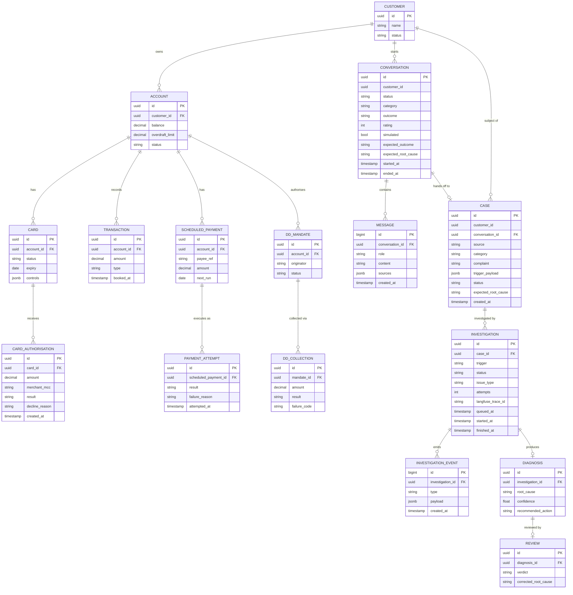

- `CONVERSATION.outcome` is `resolved`, `handed_off` or `abandoned`; `rating` comes from the 👍 / 👎 buttons.
- `CASE.category` is set by the assistant on handoff and may be changed by the copilot; `complaint` is optional when `trigger_payload` is used.
- `expected_outcome` and `expected_root_cause` are only set for simulated and seeded data and are never shown to either agent or the ops agent.
- `INVESTIGATION.status` is `queued`, `running`, `awaiting_review`, `completed` or `failed`; the `queued` rows are the job queue.
- Knowledge base chunks (`kb_chunk`: article, title, text, embedding vector) and LangGraph checkpoints live in their own tables, not shown.

The banking tables live in the Spring Boot service's schema and are seeded with scenarios that each have one known root cause and expected outcome. The simulation module uses the same scenario definitions to create fresh incidents, and the same scenarios make up the evaluation datasets.

## 10. Metrics and evaluation

### Metrics

| Metric | Agent | How it is measured |
|---|---|---|
| **Containment rate** | Assistant | Conversations resolved without a human ÷ all conversations |
| **Correct handoff decisions** | Assistant | Simulated and eval conversations: handed off when `needs_human`, resolved when `self_serve` |
| **Answer groundedness** | Assistant | LLM-as-judge: every claim backed by a cited source |
| **Customer rating** | Assistant | 👍 / 👎 per answer |
| **Category accuracy** | Both | Against the scenario's issue type (simulated and eval cases) |
| **Category change rate at handoff** | Ops copilot | How often verification changed the assistant's category |
| **Diagnosis accuracy** | Ops copilot | Matches the expected root cause, or accepted unchanged by the ops agent |
| **Time to diagnosis** | Ops copilot | Case created → diagnosis ready, and → review |
| **Handoffs per 100 conversations** | End to end | Proxy for support contacts reaching the ops team |

All metrics are stored as Langfuse scores on the conversation or investigation traces, so they can be filtered by model profile, category and prompt version.

### Evaluation loop

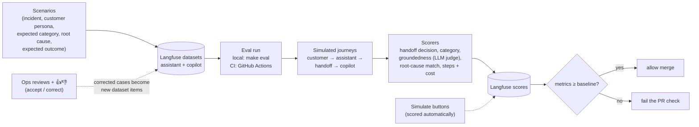

- The assistant and the copilot are also evaluated **separately**: the assistant on fixed conversation scripts (no simulated customer, so results are repeatable), the copilot on cases with fixed complaints.
- The same datasets can be run against each LiteLLM profile (`make eval PROFILE=mixed`), so Claude, the local open models and the mixed setup can be compared side by side in Langfuse. The comparison decides which aliases can move to open models:

| Profile | Triage accuracy | Diagnosis accuracy | Groundedness | Steps per investigation | Cost per investigation | p50 latency |
|---|---|---|---|---|---|---|
| `anthropic` | *to be measured* | | | | | |
| `mixed` | | | | | | |
| `ollama` | | | | | | |

- An alias moves to a cheaper model only if its own scores stay within an agreed margin (for example triage accuracy drops by at most 2 points). The `judge` alias stays on the strongest model available in each profile, so a weaker model is never graded by an even weaker one.
- While building, CI runs only unit tests (graphs tested with a fake LLM that returns scripted responses) and evals run locally on `ollama`. Once API credits are added, the CI eval job starts the Compose stack and uses the Anthropic API (the key is a GitHub Actions secret); the job is skipped while the secret does not exist. Ollama models are usually too slow for free CI runners, so the `ollama` and `mixed` profiles are always evaluated locally.

## 11. Local runtime (Docker Compose)

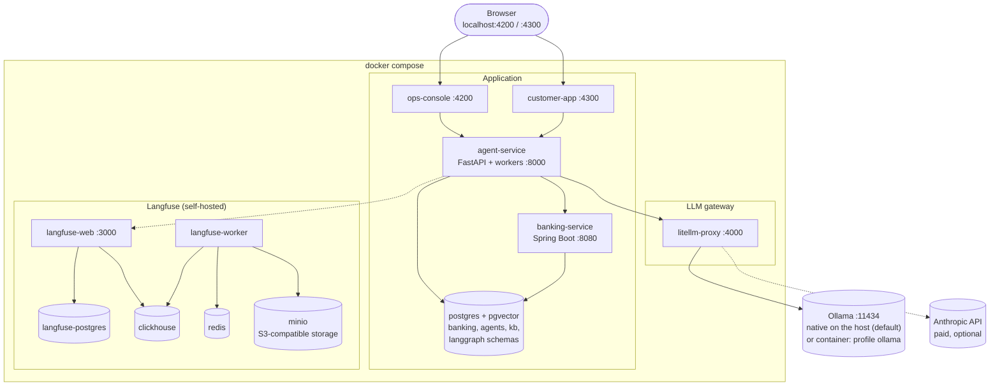

- **Ollama runs natively on the Mac** by default, because it is much faster there (it uses the GPU) than inside Docker. Install it once, run `make models` (`ollama pull` for the models in the profile), and LiteLLM reaches it at `host.docker.internal:11434` (`OLLAMA_BASE_URL`). On machines without a usable GPU, `docker compose --profile ollama up` starts an `ollama` container instead. (Compose profiles choose which containers run; `LLM_PROFILE` chooses the LiteLLM config. They are separate settings.)
- The local models need memory: roughly 5 GB for a small 8B model and around 10 GB for a 14B one. On a Mac with 16 GB, use smaller models for `reasoning` or stop other heavy containers.
- Postgres uses an image with the **pgvector** extension (for example `pgvector/pgvector:pg16`).
- No secret is needed with the default `ollama` profile. `ANTHROPIC_API_KEY` (an API key from the Claude Console, not a Claude subscription) is read from a git-ignored `.env` file for the `anthropic` and `mixed` profiles; `mixed` also needs Ollama.
- Self-hosted Langfuse brings its own Postgres, ClickHouse, Redis and MinIO; keep them separate from the app's Postgres so either can be reset independently.
- The workers and the customer simulator run inside the `agent-service` container for the POC. They can later move to their own containers (same image, different start command) to scale separately from the API.

## 12. Optional later: AWS deployment

Not needed for the POC. If the app is later hosted on AWS, the same container images move to ECS, and only the LiteLLM profile changes: the `aws` profile serves Claude **and** open-weight models through Bedrock, inside the account and region the bank chooses (or keep the Anthropic API). A fine-tuned triage model could be added through Bedrock Custom Model Import. Open models on Bedrock still cost money per token; they are cheaper, not free.

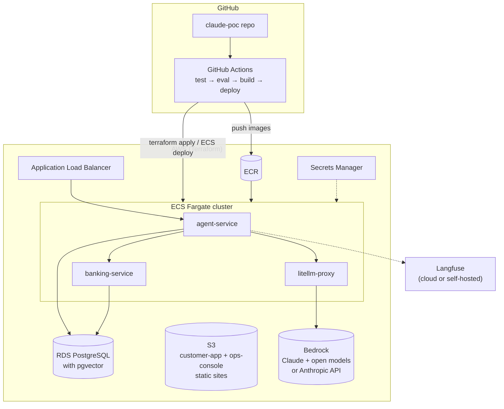

## Proposed repo layout

```
claude-poc/
├── docs/architecture.md
├── agent-service/        # Python, FastAPI, LangGraph
│   ├── core/             #   triage, tools (customer + ops scope), guardrails, kb search, llm, tracing
│   ├── assistant/        #   assistant graph + chat API
│   ├── investigation/    #   investigation graph, workers, case API
│   └── simulation/       #   customer simulator (local profile only)
├── banking-service/      # Java 21, Spring Boot (incl. simulation module)
├── frontend/             # Angular workspace
│   ├── customer-app/
│   └── ops-console/
├── knowledge-base/       # Markdown help articles
├── infra/
│   ├── docker-compose.yml
│   ├── litellm/
│   │   ├── ollama.yaml      # default profile, free, local
│   │   ├── anthropic.yaml   # paid, quality baseline for evals
│   │   ├── mixed.yaml       # open models for triage/simulator, Claude for the rest
│   │   └── aws.yaml         # optional, Bedrock
│   └── terraform/           # optional, later
├── .env.example          # LLM_PROFILE, OLLAMA_BASE_URL, ANTHROPIC_API_KEY (optional), AUTO_INVESTIGATE_TYPES, SIMULATION_ENABLED, Langfuse keys
└── .github/workflows/
```

---

## Design Q&A

Questions raised while designing, with short answers. Details are in the sections above. For a guided version with an end-to-end example, the design's history and self-check questions, see the [study guide](study-guide.md).

**Are all these technologies free to use (for example AWS Bedrock and Langfuse)?**
Almost everything is free and open source: LangGraph, LiteLLM, FastAPI, Spring Boot, Angular, PostgreSQL, Docker, Terraform, and Langfuse when self-hosted (Langfuse Cloud also has a free tier). The paid parts are LLM tokens (Anthropic API or Bedrock, pay per token, no permanent free tier) and AWS hosting (hourly charges). That is why the design is local-first: running in Docker Compose with the default `ollama` profile costs nothing, and Claude tokens are paid only once the `anthropic` or `mixed` profile is used for evals and demos.

**Does all code for all apps go in the same repo, and how do we start everything?**
Yes, one repo, with one folder per app (`agent-service`, `banking-service`, `frontend`) plus `infra/`. Each app keeps its own build tool and Dockerfile, and CI workflows run per folder. There are two ways to start: `make up` runs everything in Docker Compose (demos, evals); `make infra` runs only Postgres, LiteLLM and Langfuse in Docker while you run the app you are working on natively with hot reload. Apps read all settings from environment variables, so the same code runs both ways.

**What does "Python, managed with uv (pyproject.toml)" mean?**
`pyproject.toml` is the Python equivalent of `pom.xml` / `build.gradle`: project metadata, Python version and dependencies. `uv` is the tool that manages it, like Maven or Gradle plus SDKMAN: `uv add` adds a dependency, `uv sync` installs everything into a per-project `.venv/`, `uv.lock` pins exact versions (committed), `uv run` starts the app or tests. There is no compile step and no jar.

**How is LangGraph used, and is it really needed?**
Each agent's flow is a graph: nodes are Python functions, edges (including conditional ones) decide what runs next, and a typed state is passed between them. Strictly, a plain tool-calling loop with the Anthropic SDK could do the core work. LangGraph earns its place through durable state: an investigation pauses for human review (`interrupt()`) and resumes hours later, even after a restart. It also provides step streaming, explicit control-flow guardrails (step budgets, evidence checks) that can be tested on their own, replay for debugging, and automatic Langfuse tracing.

**Why Postgres with LangGraph? Is it common, and what are the alternatives?**
LangGraph's checkpointer saves a snapshot of the graph state after every step, keyed by thread (`investigation_id` or `conversation_id`). That is what makes pause/resume, crash recovery, replay and multiple service instances work. Postgres is the official production checkpointer and what LangGraph's own hosted platform uses, and we already run it, so it adds a schema, not infrastructure. Alternatives: in-memory (tests only), SQLite (single process, local), Redis (fast, needs durability config), MongoDB, community DynamoDB, or a custom saver. Checkpoints are serialized agent memory, not reporting data, which is why cases and diagnoses also have their own tables. Use in-memory in unit tests and Postgres everywhere else.

**How is data streamed back to the console? Do we stream the LLM response?**
Over Server-Sent Events. The graph runs in the background and emits our own event types (step started, tool call, evidence, diagnosis), mapped from LangGraph's stream modes. Every event is saved, so a refresh or reconnect replays what was missed. LLM tokens are streamed only for plain-language text people read (the customer's answer, the copilot's final explanation). Triage labels, tool calls and structured diagnoses are sent as complete events, because partial versions are useless.

**How do investigations get created, and how does an ops agent pick one? Do we just run all of them?**
Every new case is investigated automatically: creating the case also queues an investigation, and background workers pick it up. The ops agent works from a case queue and usually opens a case whose diagnosis is already waiting for review. Only enabled issue types run automatically; others are parked as `needs_manual` until the ops agent clicks Investigate. Running every scenario at once is what the evaluation run does, not the UI.

**If investigations run automatically, why do we need SSE? For retries?**
Not for retries: those happen entirely on the server (the worker retries the job and LangGraph resumes from its checkpoint). SSE matters when someone is watching a run that is still going: opening a case right after a simulation, re-running a rejected or `needs_manual` case, and the queue updating by itself. Finished runs are loaded with a normal request. Polling would also work, especially for the queue; the server side is the same either way.

**Why does the simulation live inside the banking service?**
The banking service owns the banking data and the rules that decide outcomes, so it is the only place that can create a consistent incident (for example a frozen card plus declines with the matching reason). The agents must stay read-only, so they cannot create incidents themselves. The simulation module sets up the situation and lets the real rules produce the outcome, and it is gated behind a Spring profile.

**Would this really be a separate service, with the banking service used only for the POC?**
Yes. In a real system nothing is simulated: incidents come from real activity, and test environments would use a separate traffic generator acting as the outside world. Here the banking service is itself a stand-in for core banking and its surroundings, so putting the simulation module inside it is a deliberate POC shortcut that can later move out without changing the agents.

**Is this only for complaints from users in the app, or other triggers too?**
v1 is complaint-driven: the in-app assistant, email, phone, an ops agent's own case, and simulations. The case model is generic (`source`, optional complaint, `trigger_payload`), so proactive, event-triggered investigations (for example a failed direct debit, before the customer complains) can be added later as a new source. System-wide incidents across many customers are a different problem and out of scope.

**How do we know which lookups to run? Is an LLM used to categorise issues?**
Yes, a cheap LLM call (triage) categorises each issue, but in a constrained way: it must choose from a fixed set of categories with a confidence score, and it is grounded by a signal snapshot of the customer's recent activity fetched without an LLM. Low confidence falls back to `other`. Wrong categories are caught by the evidence check and by human review. Each category then has its own investigator with a restricted tool set and a playbook checklist that guides which lookups to run. Triage accuracy is scored on its own.

**In short, what is triage?**
The first step that decides what kind of problem this is (card decline, missed payment, failed direct debit, or other), so the right specialist handles it. It is one quick, cheap classification, not the investigation itself. The term comes from hospitals, where patients are sorted before a doctor sees them.

**Can the design support both the ops copilot and the customer assistant?**
Yes, as two agents on one shared platform. The in-app assistant is the customer's first point of contact: it categorises, answers what it can, and hands off the rest as already-categorised cases with the transcript and evidence. The ops copilot verifies that category instead of trusting it blindly, investigates, and an ops agent reviews. Triage, banking tools, LLM access, guardrails and tracing are shared.

**What is Langfuse, and how is it used here?**
Open-source observability and evaluation for LLM apps. A **trace** is one run (one investigation, or one assistant reply), made of nested **observations**: graph nodes and tool calls as spans, LLM calls as generations with prompt, output, tokens, cost and latency. Traces are grouped into **sessions** (a whole conversation, or all runs on a case). **Scores** (diagnosis correct, handoff correct, groundedness, 👍/👎, ops verdicts) attach to traces; **datasets** and **experiments** run a version of the app over fixed scenarios. Data arrives through the LangChain callback handler passed to LangGraph, plus `@observe` for code outside the graphs, with a masking function applied first. Only the agent service sends traces, because it knows the node and the case; LiteLLM's own Langfuse logging stays off so calls are not recorded twice. Prompts stay in the repo (versioned with the code and tested by the eval gate), with the prompt version added to each trace. Self-hosted v3 is the heaviest part of the local stack; Langfuse Cloud's free tier is a drop-in alternative.

**What counts as an agent? Is the Python service an agent?**
An agent is an LLM using tools in a loop, where the model decides the next step and when it is done. A workflow is LLM calls along paths that our code defines. The agent service is neither: it is the host (API, workers, streaming). Inside it, triage and diagnosis are single LLM calls; the investigation graph is a workflow that enforces the mandatory process (triage, evidence, human review); the investigator subgraph is an agent, because the model chooses which banking tools to call and when it has enough evidence; and the customer assistant is a tool-using agent behind guardrails. Agentic inside, deterministic outside.

**Is the harness an agent?**
No. Agent = model + harness. The harness is everything except the model: it runs the loop, executes the tools the model asks for, manages context, enforces limits (step budgets, permissions, approvals), keeps state and records traces. Claude Code is an example: Claude is the model, the CLI is the harness, and together they are the agent. Here, LangGraph provides the generic harness machinery, our graphs, tool wrappers, guardrails and prompts make it specific to payments, and FastAPI and the workers host it.

**What are Claude Code routines, and could they help this project?**
Saved Claude Code sessions (prompt, repository, connectors) that run in Anthropic's cloud on a trigger: a schedule, an API call, or a GitHub event. They are developer tooling for work on the repo, never part of the product runtime. Useful later: checking that the architecture doc still matches the graph code, reviewing PRs against the design rules (injected `customer_id`, masking, the review `interrupt()`), investigating eval-gate failures, and proposing new scenarios. Limitation: the cloud sandbox cannot reach the local Docker stack or self-hosted Langfuse. Routines are not needed to build the project and can be added at any time without changes.

**Can the build itself run in parallel, in the cloud?**
Yes. The apps live in separate folders with clear boundaries, so separate Claude Code sessions (local git worktrees or cloud sessions, each on its own branch and PR) can build them at the same time. Contracts come first, in one session: the repo skeleton, the banking OpenAPI spec, the DB schema, the agent API and event formats, and the Compose file. Then banking service, agent core, front-ends and knowledge base/infra in parallel against those contracts, then the two graphs and the simulator, then integration and the first evals locally, where the full stack runs. One writer per folder, and every session tests against mocks of the contracts.

**When should we use routines instead of our own setup?**
Routines suit low-volume, judgment-based chores on a repo with a standard trigger, when nothing needs to be hosted. Our own setup is needed when the work is part of the product, needs local or private systems or heavy environments, has strict data rules, runs at high volume, needs a custom harness or non-Claude models, or should live in the repo as code. Deterministic jobs (tests, the eval gate, Mermaid checks, dependency updates) need no LLM at all: plain CI and Renovate. Routines are a convenience layer: when one becomes important, the same prompt can move into GitHub Actions or the Agent SDK.

**Why would anyone use open-weight models, and why here?**
In general: data control (nothing leaves your environment), lower cost at volume, fine-tuning on your own data, stable and reproducible versions, no lock-in or rate limits, offline and low-latency use, and free experimentation. The costs are weaker multi-step tool use, running the infrastructure yourself, and more safety work. Here: some banks require that payment data never leaves their environment; simulation and evals generate a lot of calls no customer sees; triage and the input guard are narrow tasks a small (possibly fine-tuned) model handles well; and local development needs no API key. The investigator loop, diagnosis and customer replies stay on a frontier model unless the evals show otherwise.

**Is it common to use open-weight models on AWS Bedrock? Are they free there?**
Yes, especially at companies already on AWS: open models (for example Llama, Mistral, DeepSeek, Qwen, gpt-oss; the catalogue changes) sit behind the same Bedrock API, IAM, logging and billing as Claude, with no GPUs to run, and fine-tuned weights can be served through Custom Model Import. They are not free: "open weight" means free to download, not free to run. Bedrock charges per token on demand, per hour for provisioned throughput, or for compute time with imported models; self-hosting means paying for GPUs. Open models save the model provider's margin and are cheaper per token when small. Ollama on a laptop is free only because the hardware is already paid for.

**How do big open-weight models compare with frontier paid models?**
On standard benchmarks the best open models are close to frontier models from a few months earlier, but benchmarks flatter them. The largest remaining gap is long agentic tasks: many tool calls, recovering from errors, knowing when to stop. Consistency, long context and resistance to prompt injection also tend to favour frontier models. Through a hosted API, big open models are often several times cheaper per token; self-hosting them needs a multi-GPU server and only pays off at high, steady volume. Licences vary. For this project, a big open model is worth testing on the investigator step via a profile, and the eval comparison decides.

**What is the case for having LiteLLM and open models in this design?**
Choosing a model is a decision we measure, not one we hard-code. All LLM calls go through LiteLLM with role-based aliases, which gives four things: the system can run fully in-house when a bank requires it; each step gets the model that fits it; simulation and evals are free to run at volume; and Langfuse compares profiles on the same datasets (accuracy, cost, latency), which also covers new model releases, price changes and outages. The gateway is one container and one YAML file per profile, less code than provider-specific clients, and it adds central keys, budgets, rate limits, fallbacks and cost tracking. The claim is not that open models are as good, but that we can measure where they are good enough.

**What is a profile here, and does every agent always use the same provider?**
A profile is one LiteLLM config file that maps the role aliases (`triage`, `assistant`, `reasoning`, `simulator`, `judge`) to real models, chosen at startup with `LLM_PROFILE`. The code only ever names an alias. A profile is not tied to one provider: `anthropic` and `ollama` use one each, while `mixed` sends triage and simulated customers to local open models and the agentic and customer-facing steps (and the judge) to Claude. Per-step aliases are what make that possible.

**What is Ollama?**
Ollama is a free tool for running open-weight models locally, a bit like Docker for LLMs: `ollama pull` downloads a model, and a local server on port 11434 exposes an OpenAI-compatible API that LiteLLM calls like any provider. It handles compressed model files, the Mac's GPU and model loading. Nothing leaves the machine and there is no per-token cost, but laptop hardware limits it to small and medium models that are weaker and slower at multi-step tool calling. Alternatives: LM Studio, llama.cpp, vLLM (for GPU servers).

**Which profile is the default, and why?**
`ollama`, so the whole system can be built and run with no API credits. The trade-offs are accepted on purpose: small local models are weaker and slower at multi-step tool calling, so investigations run one at a time, and when an agent misbehaves it can be the model rather than the code. Graph logic is therefore unit-tested with a fake LLM that returns scripted responses, so code bugs and model weakness are not confused. Once the system works end to end, API credits are added and the evals run on `anthropic` as the quality baseline and on `mixed`; the CI eval gate is switched on at the same time. An earlier version of the design made `anthropic` the default for reliability out of the box; building first for free won. `mixed` may become the default after the evals.

**Can a Claude subscription be used for the `anthropic` profile?**
No. A Claude Pro or Max subscription covers using Claude yourself (claude.ai, the desktop app, Claude Code, including building this project with Claude Code). Our own software calling Claude needs an **API key** from the Claude Console, billed separately per token from prepaid credits; a subscription login cannot be used by third-party apps. To get one: in the Console add a payment method and a few dollars of credit, set a low monthly spend limit, create a key per use (for example one for local, one for GitHub Actions), and copy it at once because it is shown only once. It goes in the git-ignored `.env` as `ANTHROPIC_API_KEY`, and only the LiteLLM container reads it.

**What are evals?**
Automated tests for LLM behaviour. Because LLM output varies and is often partly right, evals run the system over many examples and score the results instead of checking one exact answer, then compare averages between versions. The parts: a **dataset** (inputs with expected results; here, scenarios with the expected category, root cause and outcome), a **run** over every item, **scorers** (code checks, LLM-as-judge, human review) and **results** stored in Langfuse. They act as a quality gate on every change, compare model profiles, and grow as corrected ops reviews become new dataset items. **Offline** evals run before release on a fixed dataset; **online** evals score live traffic (👍/👎, the judge on real answers, ops reviews). The design uses both.

**How will the evals be implemented? Is there a library?**
Mostly our own Python plus the Langfuse SDK:
- **Scenarios** are YAML files in the repo (`agent-service/evals/scenarios/`), reviewed like code, and synced to a Langfuse dataset; corrected ops reviews are added there and exported back from time to time.
- **Each item** sets up its incident through the banking service's simulation endpoint for a fresh test customer, then runs the graph **in-process** (`investigation_graph.ainvoke(...)`, or the assistant with a fixed conversation script).
- **Scorers** are plain functions. Most are deterministic comparisons, which works because triage and diagnosis return structured output with fixed codes: `triage_correct`, `diagnosis_correct`, `handoff_correct`, plus tracked numbers such as steps used. Only groundedness uses an LLM-as-judge prompt through the `judge` alias.
- **The runner** uses Langfuse's SDK experiments: each item becomes a trace with its scores, grouped into one named run tagged with profile, git commit and prompt version.
- **The gate**: `make eval PROFILE=…` runs it, and a pytest check fails CI if any average score is below its threshold in a config file.

Optional libraries: DeepEval (ready-made answer-quality metrics in pytest style) or RAGAS (retrieval metrics for the knowledge base) if our groundedness judge is not enough; promptfoo for quick prompt and model A/B tests; Inspect AI or LangSmith's evaluate as alternatives that overlap with Langfuse. Most of the work is in the scenarios and the per-item setup, not the library.
